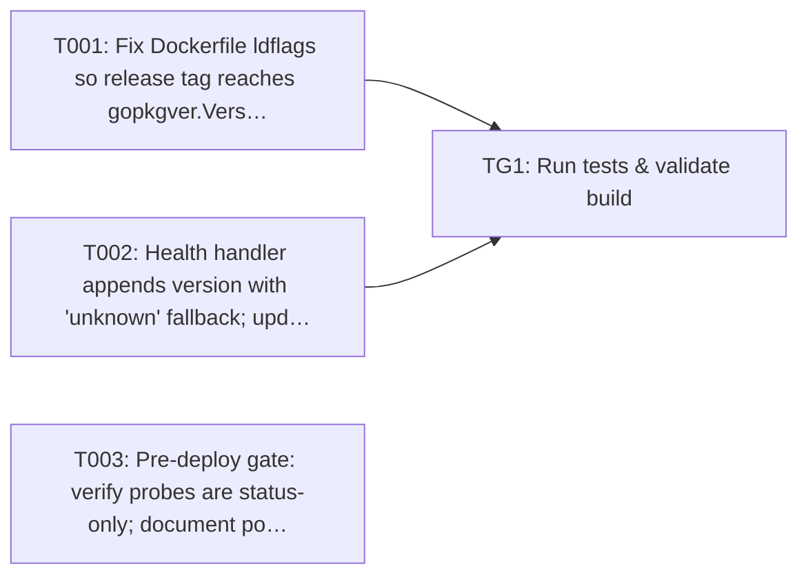

Approving locks the requirements and your decisions. Tasks are a guide; code questions go to the coding agent.

> Plan of record, not execution order: the coding agent works one repo at a time from the requirements and the approved decisions, and links its PR on the repo epic.

---
id: implementation-task-matrix
title: Implementation Task Matrix
---

## Implementation Task Matrix — wi_05d89b13853e9945e838

**Matrix ID:** `wi_05d89b13853e9945e838-r1` · **Generated:** 2026-11-13T11:42:51.888232+00:00 · **Source:** `tasks` · **Verdict:** **READY with 8 warnings**

### Summary

| Metric | Value |
| :--- | :--- |
| Tasks total | 4 |
| AI-allocated | 2 |
| Manual-allocated | 2 |
| Waves | 2 |
| Conflicts | 0 |
| Requirements uncovered | 1 |
| Low-confidence allocations (<0.6) | 1 |

### Wave 0

| Task | Title | Repo | Owner | Allocation | Confidence | Status |
| :--- | :--- | :--- | :--- | :--- | :--- | :--- |
| T001 | Fix Dockerfile ldflags so release tag reaches gopkgver.Version | Kochava/household-id-adornment-api | manual-developer | manual | 0.70 | planned |
| T002 | Health handler appends version with 'unknown' fallback; update both call sites | Kochava/household-id-adornment-api | coding-agent | ai | 0.80 | planned |
| T003 | Pre-deploy gate: verify probes are status-only; document post-deploy version sm… | Kochava/ko-k8s-apps | manual-developer | manual | 0.36 | planned |

### Wave 1

| Task | Title | Repo | Owner | Allocation | Confidence | Status |
| :--- | :--- | :--- | :--- | :--- | :--- | :--- |
| TG1 | Run tests & validate build | Kochava/household-id-adornment-api | test-change-gate | ai | 0.90 | planned |

### Dependency Graph

### Open Questions

- `T003` — Owner allocation for T003 has low confidence (0.36); confirm manual-developer manually before dispatch. (infra (SRE, manual): infra repo, SRE is manual)

### Uncovered Requirements

`PRD-089-show-the-service-version-in-the-household-id-adorn`

### Warnings

- T003: `Kochava` has no folder in the repo; check where it belongs
- T003: `Kochava/ko-k8s-apps/adornment/household-id/api/prod/api.yaml` has no folder in the repo; check where it belongs
- T003: `Kochava/ko-k8s-apps/adornment/household-id/api/base/api.yaml` has no folder in the repo; check where it belongs
- T003: `values.yaml` has no folder in the repo; check where it belongs
- T003: path not found in repo: Kochava
- T003: path not found in repo: Kochava/ko-k8s-apps/adornment/household-id/api/prod/api.yaml
- T003: path not found in repo: Kochava/ko-k8s-apps/adornment/household-id/api/base/api.yaml
- T003: path not found in repo: values.yaml

---
> Generated by: taskmatrix 0.1.0
