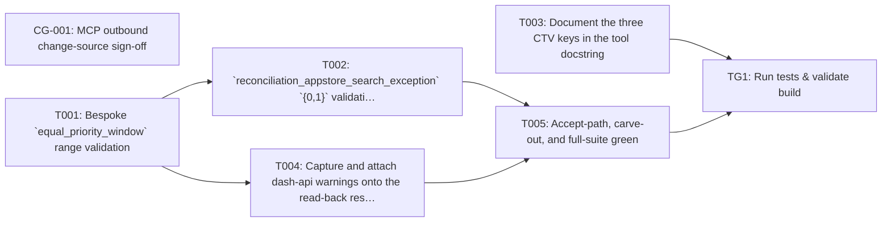

## Implementation Task Matrix — wi_prd090_68af29

**Matrix ID:** `wi_prd090_68af29-r1` · **Generated:** 2026-10-30T08:22:03.073294+00:00 · **Source:** `tasks` · **Verdict:** **BLOCKED**

### Summary

| Metric | Value |
| :--- | :--- |
| Tasks total | 7 |
| AI-allocated | 6 |
| Manual-allocated | 1 |
| Waves | 6 |
| Conflicts | 8 |
| Requirements uncovered | 2 |
| Low-confidence allocations (<0.6) | 0 |

### Wave 0

| Task | Title | Repo | Owner | Allocation | Confidence | Status |
| :--- | :--- | :--- | :--- | :--- | :--- | :--- |
| CG-001 | MCP outbound change-source sign-off | * | manual-developer | manual | 0.80 | planned |
| T001 | Bespoke `equal_priority_window` range validation | Kochava/k4a-mcp-server | coding-agent | ai | 0.80 | planned |

### Wave 1

| Task | Title | Repo | Owner | Allocation | Confidence | Status |
| :--- | :--- | :--- | :--- | :--- | :--- | :--- |
| T003 | Document the three CTV keys in the tool docstring | Kochava/k4a-mcp-server | coding-agent | ai | 0.80 | planned |

### Wave 2

| Task | Title | Repo | Owner | Allocation | Confidence | Status |
| :--- | :--- | :--- | :--- | :--- | :--- | :--- |
| T002 | `reconciliation_appstore_search_exception` `{0,1}` validation | Kochava/k4a-mcp-server | coding-agent | ai | 0.80 | planned |

### Wave 3

| Task | Title | Repo | Owner | Allocation | Confidence | Status |
| :--- | :--- | :--- | :--- | :--- | :--- | :--- |
| T004 | Capture and attach dash-api warnings onto the read-back result | Kochava/k4a-mcp-server | coding-agent | ai | 0.80 | planned |

### Wave 4

| Task | Title | Repo | Owner | Allocation | Confidence | Status |
| :--- | :--- | :--- | :--- | :--- | :--- | :--- |
| T005 | Accept-path, carve-out, and full-suite green | Kochava/k4a-mcp-server | coding-agent | ai | 0.80 | planned |

### Wave 5

| Task | Title | Repo | Owner | Allocation | Confidence | Status |
| :--- | :--- | :--- | :--- | :--- | :--- | :--- |
| TG1 | Run tests & validate build | Kochava/k4a-mcp-server | test-change-gate | ai | 0.90 | planned |

### Dependency Graph

### Conflicts

| Wave | File | Tasks | Resolution |
| :--- | :--- | :--- | :--- |
| 0 | `tools/reconciliation_tools.py` | T001, T003 | T003 moved to wave 1 (file conflict with T001 in wave 0) |
| 0 | `unit-tests/test_reconciliation_tools.py` | T001, T003 | T003 moved to wave 1 (file conflict with T001 in wave 0) |
| 1 | `tools/reconciliation_tools.py` | T003, T002 | T002 moved to wave 2 (file conflict with T003 in wave 1) |
| 1 | `unit-tests/test_reconciliation_tools.py` | T003, T002 | T002 moved to wave 2 (file conflict with T003 in wave 1) |
| 1 | `tools/reconciliation_tools.py` | T003, T004 | T004 moved to wave 2 (file conflict with T003 in wave 1) |
| 1 | `unit-tests/test_reconciliation_tools.py` | T003, T004 | T004 moved to wave 2 (file conflict with T003 in wave 1) |
| 2 | `tools/reconciliation_tools.py` | T002, T004 | T004 moved to wave 3 (file conflict with T002 in wave 2) |
| 2 | `unit-tests/test_reconciliation_tools.py` | T002, T004 | T004 moved to wave 3 (file conflict with T002 in wave 2) |

### Open Questions

- ID (For / Blocking)
- `A-2` — OQ-001 (Backend (MCP outbound plumbing owner) / PM / T004 end-to-end (FR-4/AC-5). T001/T002/T003/T005 validation+docs are **not** blocked.)
- `CG-001` — OQ-001 (Backend (MCP outbound plumbing owner) / PM / T004 end-to-end (FR-4/AC-5). T001/T002/T003/T005 validation+docs are **not** blocked.)
- `v1` — OQ-002 (PM / Eng lead / Non-blocking; affects tie-breaking only if documents later disagree)

### Uncovered Requirements

`OQ-001`, `OQ-002`

### Warnings

- grounding pinned to 87831c34; knowledge graph skipped for Kochava/k4a-mcp-server
- Open item: ID
- Open item A-2: OQ-001
- Open item CG-001: OQ-001
- Open item v1: OQ-002

### Validation Errors

- requirements coverage mismatch: 2 requirement(s) neither claimed by a task nor listed in coverage.uncovered

---
> Generated by: taskmatrix 0.1.0
