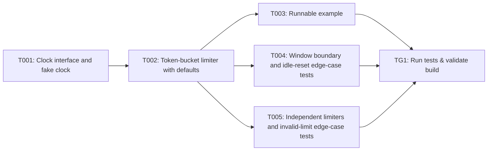

## Implementation Task Matrix — wi_prd905_fc08a3

**Matrix ID:** `wi_prd905_fc08a3-r2` · **Generated:** 2026-10-13T07:26:19.363061+00:00 · **Source:** `tasks` · **Verdict:** **READY with 5 warnings**

### Summary

| Metric | Value |
| :--- | :--- |
| Tasks total | 6 |
| AI-allocated | 6 |
| Manual-allocated | 0 |
| Waves | 4 |
| Conflicts | 0 |
| Requirements uncovered | 0 |
| Low-confidence allocations (<0.6) | 0 |

### Wave 0

| Task | Title | Repo | Owner | Allocation | Confidence | Status |
| :--- | :--- | :--- | :--- | :--- | :--- | :--- |
| T001 | Clock interface and fake clock | mayank-kochava/coding-agent-sandbox | coding-agent | ai | 0.90 | planned |

### Wave 1

| Task | Title | Repo | Owner | Allocation | Confidence | Status |
| :--- | :--- | :--- | :--- | :--- | :--- | :--- |
| T002 | Token-bucket limiter with defaults | mayank-kochava/coding-agent-sandbox | coding-agent | ai | 0.90 | planned |

### Wave 2

| Task | Title | Repo | Owner | Allocation | Confidence | Status |
| :--- | :--- | :--- | :--- | :--- | :--- | :--- |
| T003 | Runnable example | mayank-kochava/coding-agent-sandbox | coding-agent | ai | 0.90 | planned |
| T004 | Window boundary and idle-reset edge-case tests | mayank-kochava/coding-agent-sandbox | coding-agent | ai | 0.90 | planned |
| T005 | Independent limiters and invalid-limit edge-case tests | mayank-kochava/coding-agent-sandbox | coding-agent | ai | 0.90 | planned |

### Wave 3

| Task | Title | Repo | Owner | Allocation | Confidence | Status |
| :--- | :--- | :--- | :--- | :--- | :--- | :--- |
| TG1 | Run tests & validate build | mayank-kochava/coding-agent-sandbox | test-change-gate | ai | 0.90 | planned |

### Dependency Graph

### Open Questions

None.

### Warnings

- T001: path not found in repo: ratelimit/clock_test.go
- T002: path not found in repo: ratelimit/limiter_test.go
- T003: path not found in repo: ratelimit/example_test.go
- T004: path not found in repo: ratelimit/edge_test.go
- T005: path not found in repo: ratelimit/limits_test.go

---
> Generated by: taskmatrix 0.1.0
