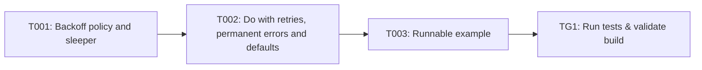

## Implementation Task Matrix — wi_prd908_1a692a

**Matrix ID:** `wi_prd908_1a692a-r1` · **Generated:** 2026-10-16T08:58:50.315882+00:00 · **Source:** `tasks` · **Verdict:** **READY**

### Summary

| Metric | Value |
| :--- | :--- |
| Tasks total | 4 |
| AI-allocated | 4 |
| Manual-allocated | 0 |
| Waves | 4 |
| Conflicts | 0 |
| Requirements uncovered | 0 |
| Low-confidence allocations (<0.6) | 0 |

### Wave 0

| Task | Title | Repo | Owner | Allocation | Confidence | Status |
| :--- | :--- | :--- | :--- | :--- | :--- | :--- |
| T001 | Backoff policy and sleeper | mayank-kochava/coding-agent-sandbox | coding-agent | ai | 0.90 | planned |

### Wave 1

| Task | Title | Repo | Owner | Allocation | Confidence | Status |
| :--- | :--- | :--- | :--- | :--- | :--- | :--- |
| T002 | Do with retries, permanent errors and defaults | mayank-kochava/coding-agent-sandbox | coding-agent | ai | 0.90 | planned |

### Wave 2

| Task | Title | Repo | Owner | Allocation | Confidence | Status |
| :--- | :--- | :--- | :--- | :--- | :--- | :--- |
| T003 | Runnable example | mayank-kochava/coding-agent-sandbox | coding-agent | ai | 0.90 | planned |

### Wave 3

| Task | Title | Repo | Owner | Allocation | Confidence | Status |
| :--- | :--- | :--- | :--- | :--- | :--- | :--- |
| TG1 | Run tests & validate build | mayank-kochava/coding-agent-sandbox | test-change-gate | ai | 0.90 | planned |

### Dependency Graph

### Open Questions

None.

---
> Generated by: taskmatrix 0.1.0
